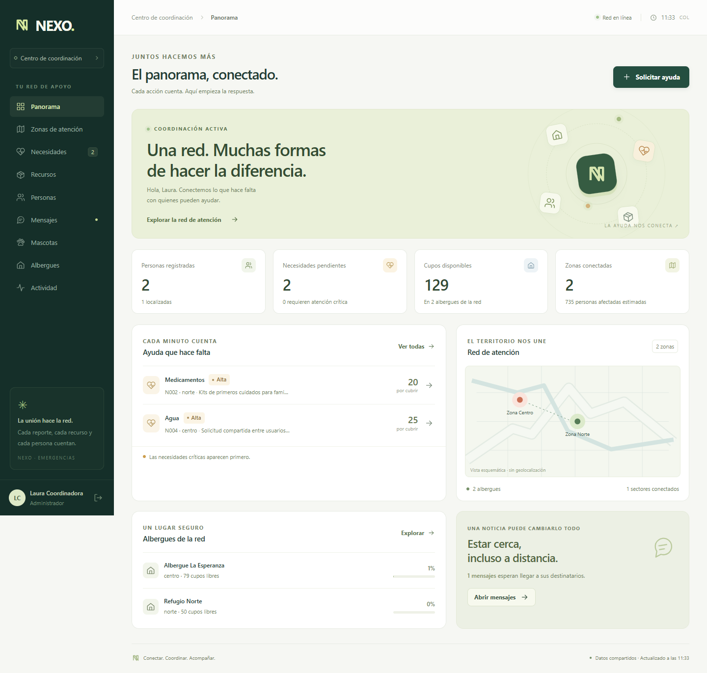

# NEXO · Centro de coordinación de emergencias

Proyecto final de Programación III: aplicación multiusuario en Elixir para
coordinar la atención posterior a un terremoto. Incluye consola e interfaz
web con **Phoenix 1.8 y LiveView 1.2**, conectadas a los mismos procesos OTP.

Vista de ejemplo; los datos de prueba de la imagen no se cargan automáticamente.

## Requisitos

- Elixir 1.17 o posterior y Erlang/OTP compatible.
- Hex: `mix local.hex --force`, si todavía no está instalado.
- Conexión a internet para descargar las dependencias la primera vez.

La persistencia utiliza archivos de texto. La construcción de JavaScript usa
el ejecutable de esbuild; no hace falta instalar Node.js ni una base de datos.

## Iniciar la interfaz web

Desde la raíz del repositorio:

~~~console
mix setup
mix phx.server
~~~

En Windows también se puede usar `mix.bat` si PowerShell restringe `mix.ps1`.
Abrir **http://localhost:4000**. Para iniciar la web y conservar una consola
Elixir dentro del mismo sistema:

~~~console
iex -S mix phx.server
~~~

En **Crear acceso** se pueden introducir nombre completo, usuario,
contraseña, rol y zona principal. Los roles corresponden a la simulación
académica del enunciado. Un usuario existente conserva sus datos y permisos
al volver a conectarse.

**Ingresar** exige una cuenta previamente registrada y su contraseña correcta;
no crea usuarios. **Crear acceso** registra una cuenta nueva y rechaza nombres
de usuario que ya existen. El comando `connect` de la consola conserva el
registro automático solicitado en el enunciado del proyecto.

### Primer recorrido

1. Crear un acceso como coordinador o administrador.
2. En **Zonas de atención**, registrar una zona; sus códigos se utilizan en
   los demás formularios. También se pueden agregar sectores y puntos.
3. En **Recursos**, registrar suministros, su ubicación, categoría y zona.
4. En **Necesidades**, registrar una solicitud y asignarle recursos
   compatibles. Después se puede actualizar el estado de la atención.
5. Registrar albergues, personas, mensajes y reportes de mascotas desde sus
   respectivas pantallas. **Más acciones** muestra las operaciones adicionales.

La aplicación empieza sin datos de ejemplo. Los contadores y las tablas
reflejan los registros reales. La vista de la red de zonas es esquemática;
no representa coordenadas geográficas.

### Funcionalidades web

- Panorama con prioridades, ocupación, cupos y mensajes pendientes.
- Zonas, sectores y puntos de atención con estadísticas acumuladas.
- Solicitudes, asignaciones, cancelaciones y cambios de estado.
- Inventario por zona, entradas, salidas, transferencias e historial.
- Personas, búsqueda e historial de estados.
- Mensajes familiares pendientes o entregados.
- Mascotas perdidas/encontradas, similitud y confirmación de reencuentros.
- Albergues, ingresos, salidas y vínculos con recursos y necesidades.
- Actividad propia; el administrador también puede ver la del equipo.
- Filtros, formularios, navegación móvil y actualizaciones entre usuarios.

Los permisos se verifican en el servidor para cada operación. La cookie del
navegador contiene un token opaco; la sesión original se valida nuevamente y
caduca a las ocho horas. Cerrar sesión revoca el acceso de sus pestañas.

## Consola

~~~console
iex -S mix
~~~

~~~elixir
Emergencias.iniciar()
~~~

Dentro de la consola, `help` muestra los comandos disponibles para el rol.
Si ya se inició Phoenix con `iex -S mix phx.server`, se puede abrir la consola
en esa misma sesión. Las pestañas web comparten los procesos de esa instancia.
Ejecutar otro `mix` o `iex` por separado crea otra instancia en memoria.

### Conflicto concurrente

Desde IEx:

~~~elixir
Emergencias.demo_conflicto()
~~~

Dos coordinadores solicitan simultáneamente 30 y 25 litros de un inventario
de 50. Solo una asignación se confirma y el saldo final queda en 20 o 25.
La demostración crea registros propios con identificadores únicos.

## Persistencia

Los datos se guardan en `data/*.csv` con separador `|`. La consola y la web
utilizan los mismos archivos y procesos. Los archivos de datos se excluyen
de Git para no versionar registros personales.

Para usar una carpeta separada durante una demostración, en PowerShell:

~~~powershell
$env:EMERGENCIAS_DATOS_DIR = "data/demostracion"
mix.bat phx.server
~~~

Elegir la carpeta **antes de arrancar**. Reiniciar el servidor recupera sus
datos. Para volver a la carpeta normal, cerrar la aplicación y ejecutar:

~~~powershell
Remove-Item Env:EMERGENCIAS_DATOS_DIR
~~~

## Pruebas

~~~console
mix test
~~~

Las pruebas de dominio trabajan en memoria. Las de persistencia comprueban
lectura y escritura con archivos temporales. Las pruebas web cubren acceso,
sesiones revocadas y vencidas, permisos, formularios y actualizaciones desde
la consola.

## Organización

~~~text
lib/emergencias/          Dominio, GenServer, supervisión y persistencia
lib/emergencias_web/      Endpoint, rutas, sesiones HTTP y pantallas LiveView
assets/js/app.js          Conexión LiveView y comportamiento del navegador
priv/static/assets/      Diseño CSS y JavaScript generado
config/                  Configuración por entorno
test/                    Pruebas de dominio y de la interfaz
~~~

`Comandos.ejecutar_operacion/3` permite que los formularios compartan la
autorización y la actividad de la consola sin convertir los campos en líneas
de comandos. `Emergencias.Eventos` distribuye las actualizaciones mediante
Phoenix PubSub.

## Compilación para producción

~~~console
mix assets.deploy
~~~

El entorno de producción requiere `SECRET_KEY_BASE` (generable con
`mix phx.gen.secret`), `PHX_HOST` y HTTPS. `PORT` permite cambiar el puerto;
`PHX_SERVER=true` activa el servidor al iniciar una release. La configuración
incluida sirve en la dirección local de la máquina.
